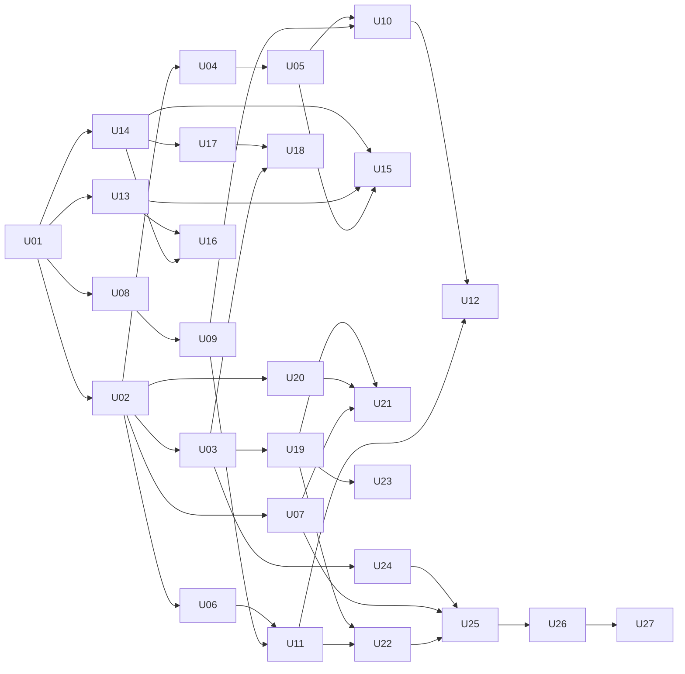

# Proving Ground software plan

This plan turns the software tasks of the four missions into 27 units. A unit is one change that ends in a check you can run. The mission plan (`Proving Ground mission plan, software and hardware.docx`) stays the source for goals and "done when" lines. This file says how to build the software side.

The app is one static web app with four views: the site finder, the Sun panel, the ground-truth chart, and the live panel. A Python pipeline fetches data and writes static files. The app reads those files and the pod. There is no server.

## How to read this

- Each unit has an id, the units it depends on, what to build, and a check.
- Mark a unit done only when its check passes. Paste the check output in the pull request.
- Units in different tracks can run in parallel once their dependencies are done.
- Build every pod unit against the simulator from U03 first. The real pod log arrives late.

## Decisions that shape every unit

| Decision | Choice | Reason |
|---|---|---|
| Split of work | Python fetches and reduces data. TypeScript scores, combines, and draws. | Each rule lives in one language, so the map and the card cannot disagree. |
| Sun math | One Python function, `sun_position`, used for the grid and for the pod prediction. | Mission 2 checks the Sun code against the real Sun. The check must cover the code the map uses. |
| Scoring | In the browser, from raw layers. | Target, test, and tolerance change without a pipeline rerun. One month is about 62,000 cells, which scores in milliseconds. |
| Pod contract | One channel registry, `shared/channels.json`, read by the pipeline, the app, and the firmware author. | The mission plan requires pod names and units to match card rows. One file enforces it. |
| Live link | Web Serial over USB, with a replay source for tests. | No WiFi dependency at the demo table. Works in Chrome and Edge on a laptop. |
| Hosting | Static files only. All data ships in the build. | The demo must run with no network. |
| Stack | Vite, React, TypeScript, Vitest, uPlot, d3-geo on canvas. Python with requests, numpy, pytest. | Common tools, no tile server, no map key. |

## Facts measured on 11 November 2026

These come from live API calls, not from documentation.

- NASA POWER climatology returns `TS`, `TS_MAX`, `TS_MIN`, `T2M`, `RH2M`, `PS`, `ALLSKY_SRF_ALB`, `ALLSKY_SFC_UV_INDEX`, and `ALLSKY_SFC_SW_DWN` for a point near Doha. The period is 2001 to 2025.
- The POWER regional endpoint accepts one parameter and at most 10 by 10 degrees per request. A request took about 1 second. The grid step is 0.5 degrees in latitude and 0.625 degrees in longitude, so "half-degree" is exact in latitude only.
- `PS` is in kPa. `ALLSKY_SFC_UV_INDEX` is a UV index. `TS_MAX` and `TS_MIN` look like monthly extremes, not mean daily values (January at Doha gives 32.35 and 6.61 C). Confirm before you call their difference a day-to-night range.
- POWER hourly meteorology (`T2M`, `RH2M`, `PS`, `TS`) lagged 2 days. Hourly solar, UV, and albedo had no valid value in the last 18 days. The satellite curve for the pod's own day will not exist for those channels.
- JPL Horizons returns Sun azimuth and elevation for an observer at `coord@301`, longitude 222.69, latitude -89.45. Over November 2026 the elevation stays between 1.0 and 2.1 degrees while the azimuth turns through 360 degrees.
- The MEDA derived archive is at `https://atmos.nmsu.edu/PDS/data/PDS4/Mars2020/mars2020_meda/data_derived_env/`, in folders of sols up to sol 1859. File names inside a sol folder are not yet checked.
- The same Horizons call for Jezero (`coord@499`) returned no rows in a first try. Treat the Mars Sun path as unproven.

## Unit map

| Track | Units | Mission |
|---|---|---|
| Foundation | U01 to U03 | All |
| Data | U04 to U07 | 1, 3 |
| Site finder | U08 to U12 | 1 |
| Sun | U13 to U18 | 2 |
| Ground truth | U19 to U23 | 3 |
| Live and submission | U24 to U27 | 4 |

## Foundation

### U01. Scaffold the repo

**Depends on.** None.

**Build.**
- [ ] Create `app/` with Vite, React, TypeScript, and Vitest.
- [ ] Create `pipeline/` with `pyproject.toml` and pytest.
- [ ] Create `shared/` for files that both sides read.
- [ ] Add a GitHub Actions workflow that runs `npm test`, `npm run build`, and `pytest`.

**Check.** The workflow passes on a pull request that contains one trivial test on each side.

### U02. Write the channel registry and the source registry

**Depends on.** U01.

**Build.**
- [ ] Create `shared/channels.json` with one entry per channel. Each entry has `id`, `label`, `unit`, `podField`, `powerParameter`, `medaProduct`, and `onCard`.

| id | Unit | Pod sensor | POWER parameter | On card |
|---|---|---|---|---|
| `ground_temp` | C | MLX90614 | `TS` | Yes |
| `reflectivity` | ratio, 0 to 1 | BH1750 down over BH1750 up | `ALLSKY_SRF_ALB` | Yes |
| `uv` | UV index | UV sensor | `ALLSKY_SFC_UV_INDEX` | Yes |
| `air_temp` | C | DHT22 | `T2M` | Yes |
| `humidity` | % | DHT22 | `RH2M` | Yes |
| `pressure` | hPa | BMP280 | `PS`, converted from kPa | Yes |
| `ground_temp_10cm` | C | DS18B20 | None | No |

- [ ] Create `shared/sources.json`. Each entry has `id`, `name`, `url`, `usedFor`, and `accessed`.
- [ ] Add a loader on each side that fails on an unknown field or a missing unit.

**Check.** A test on each side loads both files. A test proves that a channel with no unit fails to load.

### U03. Define the pod line format and build the simulator

**Depends on.** U02.

**Build.**
- [ ] Write `docs/pod-protocol.md`. One record is one CSV line with the header `ts,lux_up,lux_dn,tg,uv,ta,rh,p,t10`. `ts` is UTC in ISO 8601. An empty field means the sensor gave no reading.
- [ ] Write `parsePodLine` in `app/src/pod/parse.ts`. It returns a typed record or a typed error. It never throws.
- [ ] Write `tools/pod_sim.py`. It writes a 24-hour log at one record per minute, and it can print records at one per second for the live panel.
- [ ] Give the protocol file to the firmware author.

**Check.** Tests cover a good line, a line with an empty field, a line with text in a number field, and a short line. The simulator log parses to 1,440 records with zero errors.

## Data

### U04. Pull the Earth grid from NASA POWER

**Depends on.** U02.

**Build.**
- [ ] Write `pipeline/fetch_power.py`. It requests the climatology regional endpoint in 10 by 10 degree tiles, one parameter per request.
- [ ] Save each response to `data/raw/power/<parameter>/<tile>.json` before any processing. Skip a tile that already exists.
- [ ] Fetch the eight parameters from U02 plus `TS_MAX` and `TS_MIN`. A full run is 648 tiles per parameter, about 90 minutes at the measured 1 second per request. Start it early.
- [ ] Retry a failed tile three times with a wait, then log the tile and continue.

**Check.** A second run makes zero requests and prints `0 fetched, N cached`. The value for the Doha cell equals the value from the point endpoint.

### U05. Pack the monthly layers

**Depends on.** U04.

**Build.**
- [ ] Write `pipeline/pack.py`. It keeps land cells only and writes one file per month, `app/public/data/earth/month-MM.bin`, as Int16 with a scale and an offset per quantity.
- [ ] Write `app/public/data/earth/manifest.json` with the cell list, the quantity order, units, scale, offset, and the fill value.
- [ ] Derive the card quantities here: ground temperature range, albedo, UV index, air temperature, humidity, and pressure in hPa.
- [ ] Write `loadMonth` in `app/src/data/earth.ts`.

**Check.** A round-trip test packs a known cell and reads the same value back within the scale step. Each month file is under 2 MB.

### U06. Record the target values

**Depends on.** U02.

**Build.**
- [ ] Create `shared/targets.json` with two targets, Shackleton Connecting Ridge and Jezero crater.
- [ ] For each target and channel, record `value`, `unit`, `tolerance`, and `sourceId`. A value with no measurement, such as lunar humidity, is `null` with a `reason`.
- [ ] Record the fixed limits block per target as a list of sentences. Take the text from the project brief.
- [ ] Take Jezero values from the MEDA sol in U07, not from memory.

**Check.** A test fails when a value has no `sourceId` or a tolerance of zero.

### U07. Fetch one Mars day from MEDA

**Depends on.** U02.

**Build.**
- [ ] Open one sol folder in the derived archive and write down the real file names in `docs/meda-files.md`.
- [ ] Pick one reference sol with data in every channel the pod copies.
- [ ] Write `pipeline/fetch_meda.py --sol N`. It writes `app/public/data/mars/meda-sol-N.json` with one time series per channel, keyed by local mean solar time.

**Check.** The output has all six card channels. A channel with no MEDA product has `missing` and a reason, not an empty list.

## Site finder (Mission 1)

### U08. Score one quantity

**Depends on.** U01.

**Build.**
- [ ] Write `score(value, target, tolerance)` in `app/src/score/score.ts`. It returns `max(0, 1 - |value - target| / tolerance)`.
- [ ] Return a typed "no score" result when the value or the target is missing. Do not return 0 for missing data.

**Check.** Table tests cover an exact match (1), a gap of one tolerance (0), a gap of half a tolerance (0.5), and a missing value.

### U09. Combine scores for the power test and the mobility test

**Depends on.** U08.

**Build.**
- [ ] Create `shared/tests.json` with a weight per quantity for each test. Take the weights from the brief.
- [ ] Write `combine(scores, weights)`. It returns the weighted mean and the list of quantities that had no score.

**Check.** Tests prove that weights sum to 1, and that a missing quantity appears in the returned list.

### U10. Draw the world map with a month slider

**Depends on.** U05, U09.

**Build.**
- [ ] Draw the combined score per cell on a canvas with d3-geo, plus coastlines from a bundled Natural Earth file.
- [ ] Add selectors for target and test, and a slider for the month.
- [ ] Show the top 20 cells for the chosen month in a ranked list beside the map.
- [ ] Open the fidelity card when the user clicks a cell or a list row.

**Check.** With the network off, the map draws and the slider changes the month in under 200 ms, read from `performance.now()` in the console.

### U11. Build the fidelity card

**Depends on.** U06, U09.

**Build.**
- [ ] Show one row per card channel with the Earth value, the target value, the tolerance, the score, and a tag that reads "estimate" or "measured".
- [ ] Show the pressure row with its real score. Do not hide a failed row.
- [ ] End the card with the fixed limits block from `shared/targets.json`.
- [ ] Give the card a URL, such as `#/card/qatar`.

**Check.** A component test renders six rows and the limits block last. The pressure row shows a score of 0 against Jezero.

### U12. Run the check on the four NASA sites

**Depends on.** U10, U11.

**Build.**
- [ ] Create `shared/validation_sites.json` with the four sites from the brief.
- [ ] Write a script that prints, for each site, its best month, its score, and its rank percentile among all land cells.
- [ ] Write the output to `docs/validation.md`. Include every site, also the ones that rank low.

**Check.** `docs/validation.md` has four rows. Mission 1 is done when one target and one test work from map to card.

## Sun (Mission 2)

### U13. Fetch the Sun path at the target from JPL Horizons

**Depends on.** U01.

**Build.**
- [ ] Write `pipeline/fetch_horizons.py`. Use `COMMAND='10'`, `CENTER='coord@301'`, `SITE_COORD='222.69,-89.45,0'`, `QUANTITIES='4'`, and a 1-hour step over 30 days.
- [ ] Write `app/public/data/sun/shackleton.json` with time, azimuth, and elevation.
- [ ] Try the same call for Jezero with `coord@499`. If it fails, record the error in the output file and ship the Moon only.

**Check.** The Moon file has about 720 rows, and the elevation stays between 0 and 3 degrees.

### U14. Compute the Sun angles on Earth

**Depends on.** U01.

**Build.**
- [ ] Write `sun_position(lat, lon, utc)` in `pipeline/sun.py`. It returns azimuth and elevation.
- [ ] Compute three numbers per latitude row and month: peak elevation, mean elevation while the Sun is up, and the fraction of the day the Sun is up. The daily path depends on latitude and date only, so compute per row and copy to every cell in the row.
- [ ] Add the three numbers to the monthly layers from U05.

**Check.** A test compares `sun_position` with a Horizons query for Doha at six times. Every angle agrees within 0.5 degrees.

### U15. Feed the Sun match into the power score

**Depends on.** U13, U14, U05.

**Build.**
- [ ] Compute the same three numbers for the target from the Horizons file.
- [ ] Add them to `shared/targets.json` and to the power test weights in `shared/tests.json`.

**Check.** With the Moon target and the power test, the top cells for March and September sit at high latitude. A test asserts that the best latitude is above 80 degrees north or south.

### U16. Show the two skies side by side

**Depends on.** U13, U14.

**Build.**
- [ ] Draw two plots with azimuth on the x axis and elevation on the y axis. The left plot is the target. The right plot is the chosen Earth cell and month.
- [ ] Print the three numbers under each plot.

**Check.** The Moon plot shows a flat line near the horizon across 360 degrees of azimuth.

### U17. Predict sunrise, sunset, and peak time for the pod site

**Depends on.** U14.

**Build.**
- [ ] Write `pipeline/sun_predict.py --lat --lon --date`. It calls `sun_position` at 1-minute steps and writes `app/public/data/sun/pod-prediction.json`.

**Check.** The predicted times for Doha on the field date are within 2 minutes of a Horizons rise, transit, and set query.

### U18. Overlay the measured light curve and print the gap

**Depends on.** U17, U03.

**Build.**
- [ ] Write `detectSunEvents(records)`. Sunrise and sunset are the times `lux_up` crosses a threshold. Peak time is the center of the top 5 percent of readings.
- [ ] Plot the predicted elevation curve and the measured `lux_up` curve on one time axis.
- [ ] Print the three gaps in minutes beside the Sun panel.

**Check.** On the simulator log, the three gaps match the offsets the simulator was given. Mission 2 is done when the real log shows its gaps in minutes.

## Ground truth (Mission 3)

### U19. Import the pod log

**Depends on.** U03.

**Build.**
- [ ] Load `app/public/data/pod/qatar.csv` at start. Also accept a file dropped on the page.
- [ ] Parse with `parsePodLine`. Show the count of good and bad lines.
- [ ] Compute reflectivity as `lux_dn / lux_up`. Give no value when `lux_up` is below a daylight threshold.

**Check.** The simulator log imports with 1,440 good lines. A test proves that reflectivity at night has no value.

### U20. Get the satellite curve for the pod's grid cell

**Depends on.** U02.

**Build.**
- [ ] Write `pipeline/fetch_power_hourly.py --lat --lon --date`. It writes `app/public/data/earth/qatar-hourly.json`.
- [ ] For a channel with no hourly value on the pod's date, use the monthly climatology value as a flat line and label it "monthly mean" in the file.

**Check.** Every card channel in the output has either a 24-point series or a labelled monthly mean.

### U21. Plot three curves per channel

**Depends on.** U19, U20, U07.

**Build.**
- [ ] Draw one uPlot chart per channel with the pod curve, the satellite curve, and the MEDA curve, on a local-time axis.
- [ ] Compute the gap as the mean absolute difference between the pod and the satellite value. Draw it as the error bar.

**Check.** Six charts render from the simulator log. The printed gap for one channel equals a hand calculation in a test.

### U22. Fill the measured rows on the Qatar card

**Depends on.** U19, U11.

**Build.**
- [ ] Reduce each pod channel to the same daily number the card uses.
- [ ] Replace the estimate with the measurement, set the tag to "measured", and show the error bar from U21.
- [ ] Score each measured row against Jezero with `score` from U08.

**Check.** With the simulator log, the Qatar card shows six measured rows, each with an error bar and a Mars value. Mission 3 is done when the same holds for the real log.

### U23. Compare the surface and the 10 cm temperature curves

**Depends on.** U19.

**Build.**
- [ ] Plot `tg` and `t10` on one chart.
- [ ] Print the delay between the two peaks in minutes and the ratio of the two daily ranges.

**Check.** On the simulator log, the printed delay equals the delay the simulator was given.

## Live panel and submission (Mission 4)

### U24. Read the pod live

**Depends on.** U03.

**Build.**
- [ ] Write a Web Serial source that reads lines and passes each one to `parsePodLine`.
- [ ] Write a replay source that plays a log file at a chosen speed. Both sources have the same interface.
- [ ] Reconnect when the cable drops. Keep the last 600 records in a ring buffer.

**Check.** The simulator, piped to a serial port or through the replay source, shows records in the console. Unplug and replug the cable, and records resume with no page reload.

### U25. Build the live panel

**Depends on.** U24, U07, U22.

**Build.**
- [ ] Show each pod channel as it arrives, beside the MEDA value for the same local time.
- [ ] Update the reflectivity and ground temperature rows on every record.
- [ ] Add a link to the Qatar card that takes one click.

**Check.** With the replay source, a step change in `lux_dn` changes the reflectivity row within one record.

### U26. Harden the demo

**Depends on.** U25.

**Build.**
- [ ] Add a reset button that clears the live buffer without a reload.
- [ ] Run the full demo twice in a row with the network off.
- [ ] Write the demo steps in `docs/demo.md`.

**Check.** Two runs pass with no restart, and memory in the browser task manager is flat after 10 minutes of stream.

### U27. Submit

**Depends on.** U26.

**Build.**
- [ ] Deploy the static build and record the public link.
- [ ] Generate the references list from `shared/sources.json` into `docs/references.md`. Add every reused library.
- [ ] Record the 30-second video with field footage of the pod.
- [ ] Write the submission text. Submit by 9 pm Sunday.

**Check.** The public link opens the app in a private window. The references list has an entry for every file under `app/public/data/`.

## Order of work and what to cut

1. Do U01, U02, and U03 first. Every other unit needs them.
2. Start the U04 fetch as soon as U02 is done. It runs for about 90 minutes.
3. Run the four tracks in parallel: site finder, Sun, ground truth, and live.
4. If time runs short, cut in this order: U23, U16 for Mars, U12 beyond the table, U15.
5. Never cut U11, U22, U25, or U27. The "done when" lines of the missions depend on them.

## Open questions

- [ ] The project brief is not in this repo. It names the data sources, the four NASA sites, the test weights, and the limits text. Add the brief, or fill U06, U09, and U12 by hand.
- [ ] The three numbers for the Sun match in U14 are a proposal. If the brief names other numbers, use those.
- [ ] Confirm what `TS_MAX` and `TS_MIN` mean in the POWER climatology before U05 uses them.
- [ ] Agree the UV unit. The pod sensor, MEDA, and POWER may each report a different quantity.
- [ ] Read the 13 November guides for rules on code written before the event.
- [ ] Fix the pod's field date and position. U17 and U20 need both.
