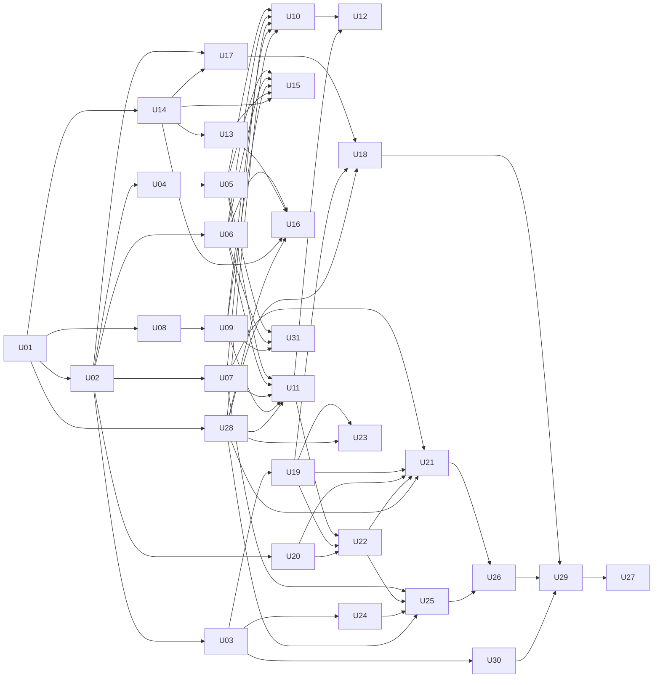

# Proving Ground software plan

This plan turns the software tasks of the four missions into 31 units. A unit is one change that ends in a check you can run. `docs/mission-plan.md` holds the goals and the "done when" line of each mission. `docs/project-brief.md` holds the idea, the scoring rules, the four known sites, and the limits text. `docs/verified-facts.md` holds every endpoint, file name, column name, and test value that a real call returned. This file says how to build the software side.

The app is one static web app with four views: the site finder, the Sun panel, the ground-truth chart, and the live panel. A Python pipeline fetches data and writes static files. The app reads those files and the pod. There is no server.

## How to read this

- Each unit has an id, the units it depends on, the skills to load, its inputs, what to build, and a check.
- Every input carries a status tag. `AGENTS.md` defines the four tags and what to do for each one.
- Mark a unit done only when its check passes. Paste the check output in the pull request.
- Units in different lanes can run in parallel once their dependencies are merged. "Who does what" assigns each unit to a lane.
- Build every pod unit against the simulator from U03 first. The real pod log arrives late.
- A line marked HUMAN TASK is work for a person. An agent does not attempt it.

## Decisions that shape every unit

| Decision | Choice | Reason |
|---|---|---|
| Split of work | Python fetches and reduces data. TypeScript scores, combines, and draws. | Each rule lives in one language, so the map and the card cannot disagree. |
| Sun math | One Python function, `sun_position`, used for the grid and for the pod prediction. The browser never computes a Sun angle. | Mission 2 checks the Sun code against the real Sun. The check must cover the code the map uses. |
| Scoring | In the browser, from raw layers. | Target, test, and tolerance change without a pipeline rerun. |
| Pod contract | One channel registry, `shared/channels.json`, read by the pipeline, the app, and the firmware author. | The mission plan requires pod names and units to match card rows. One file enforces it. |
| Live link | Wi-Fi first, as the mission plan says, with USB serial as the fallback and a replay source for tests. All three carry the same lines. | The pod needs Wi-Fi at start-up to get the time. A cable still works when the hotspot fails. |
| Hosting | Static files only. All data ships in the build. | The field recording must not depend on a network. |
| Numbers | The pipeline writes every measured or fetched number to `app/public/data/`. Settings that the plan chose live in `shared/`. | No number is typed into a component. |
| Time axis | Local mean solar time, computed as UTC plus longitude divided by 15, in hours. | MEDA files are keyed by local mean solar time. The same axis works on Earth and needs no time zone. |
| Stack | Vite, React, TypeScript, Vitest, uPlot, d3-geo on canvas. Python with requests, numpy, pytest. The Arduino core for ESP32 with `arduino-cli`, for the firmware only. | Common tools, no tile server, no map key. |
| Team documents | A unit may use text and values from `docs/project-brief.md` and `docs/mission-plan.md` as written, with that file as the source. Where the two differ, the mission plan wins. Where a real call differs from either, the real call wins. | The brief says of itself: "Nothing in this brief has been run yet." |

## Facts that changed the plan

`docs/verified-facts.md` has the calls and the full results. These five results changed units.

- POWER serves two grids. Temperature, humidity, and pressure come at 0.5 by 0.625 degrees. Albedo and UV come at 1 by 1 degree. U05 holds the rule that joins them.
- `TS_MAX` and `TS_MIN` are extremes over 25 years. The plan no longer uses them. `TS_RANGE` gives the day-to-night range.
- The MEDA derived folder has pressure and humidity only. Ground and air temperature are in the calibrated folder. No MEDA file gives a UV index or a reflectivity value.
- The Horizons call for Jezero works when the longitude is `-77.45`.
- POWER hourly data lagged 31 hours for temperature. It had no value at all for albedo and UV. U20 asks for hourly data first, and uses the monthly climatology under its own name when the hours are missing. For a log that ends on Sunday, expect the climatology.

## What the brief and the new mission plan changed

The team added the project brief and a new mission plan on 12 November 2026. These ten points changed units.

- The pod is a printed stick on a pole. Its ground sensors tilt 30 degrees and face south. The app divides the light ratio by a correction factor from the log header. U03, U19, and U22 hold this.
- The pod's code is a software task. U30 writes it.
- The pod reads every sensor every 2 seconds, streams over Wi-Fi, and logs one-minute averages to its own memory. U03, U24, and U30 hold this.
- The UV sensor is a GUVA-S12SD module. It gives an approximate UV index.
- The brief names the three Sun numbers. They replace the three that this plan had chosen. U14 holds them.
- The brief says which quantities drive each test. The power test no longer counts air temperature, humidity, pressure, or reflectivity. Those rows stay on the card, each with a score of its own. U09 holds this.
- The brief names the four known sites and the pass rule. U12 holds them.
- The brief gives the limits text. U06 copies it, and U11 and U16 show it.
- The mobility test needs slope and roughness, bare ground, and dryness. Only dryness has a confirmed source. U31 holds this.
- Mission 4 is done when the demo runs twice in a row without a restart. U26 checks it.

The brief asks for more than this plan builds. Each gap shows in the app as a reason, never as a made-up value.

| Brief item | Here |
|---|---|
| Slope and roughness, and bare ground | U31 looks for a source. None is confirmed. |
| Airborne dust | Not built. POWER serves `AOD_55` [VERIFIED], but no confirmed file gives a Mars value to compare with. |
| Sunlight | Not built. The pod measures lux, and the band of each MEDA light channel is [UNVERIFIED]. |
| The communications, navigation, and science tools tests | Not built. The brief lists them as should-have. The selector shows them as disabled. |
| Weights that the user can change | Not built. The brief lists it as should-have. |
| Earth data from MODIS, SRTM, MERRA-2, and SMAP | This plan takes every built Earth row from NASA POWER, because real calls confirmed its endpoints. |
| Moon values from Diviner | The brief gives no value. Each Shackleton value stays `null`. |

## The clock

Today is Thursday 12 November 2026. The team's target for submission is Sunday 15 November at 9 pm. The hard deadline is 11:59 pm local time.

- The pod is the hard limit on this plan. Buying the parts, printing the stick, wiring the board, and flashing it are HUMAN TASKS. U30 writes the firmware, and it needs `docs/pod-protocol.md` from U03.
- The brief says: "'Before Saturday' means feasibility checks and reading only. Build the product during the event." [NEEDS HUMAN] Read the 13 November guides and decide whether a unit may start before Saturday. If none may, 31 units do not fit in two days. Then build only the units that a "done when" line needs, and cut in the order under "Order of work".
- The pod logs for 24 hours. The video needs the finished log. The brief plans to deploy on Saturday morning and to collect on Sunday morning. The last safe start for the log is Saturday 14 November at 10:00 local time [DEFAULT, our estimate]. A later start leaves no time to import, film, edit, and submit. So U03 and U30 must merge, and the board must log on a table with no gaps, before Saturday morning.
- The brief sets five checkpoints. Saturday 2 pm: real data shows on the map for one target, which needs U05 and U10. Saturday 10 pm: one target and one test work from data to card, which needs U11. Sunday noon: the pod streams live and is ready to film, which needs U25 and U30. Sunday 6 pm: feature freeze. Sunday 9 pm: submit.
- If the real log never arrives, the app still runs on the simulator log, and every view says "simulated". The "done when" lines of Missions 1, 2, and 3 then stay open. Do not present the simulator log as a field measurement.
- The start time in D10 is a test value for the simulator. It is not the planned start of the field log.
- Film the live clip in daylight. Horizons puts sunset at the test site at 13:47 UT on 14 November [VERIFIED].
- Film the shading clip after the 24-hour log ends. If the team films it during the log, write the start and end time in `shared/pod_site.json` under `exclude`, and U19 drops those minutes.
- Expect no same-day satellite curve. A log that ends on Sunday needs POWER hourly data that arrives on Monday or later.
- The longest chain of units is U01, U02, U04, U05, U11, U22, U21, U26, U29, U27. Each one waits for the merge of the one before. Start U04 as soon as U02 merges, because its fetch runs for 1 to 3 hours.

## What the team must supply

Each row is NEEDS HUMAN. The unit leaves the field `null` with a `reason` and builds everything else. The app shows the reason where the value would be. The brief and the new mission plan supplied the four known sites, the limits text, the test rules, and the UV sensor model, so those rows are gone.

| Input | Needed by | Until it arrives |
|---|---|---|
| Shackleton values for ground temperature, reflectivity, UV, air temperature, humidity, and pressure, each with a citation. The brief names Diviner as a source and gives no value. | U06 | Each value is `null`. The Moon score uses the three Sun numbers only. |
| A citation for the Moon site coordinates and the Jezero coordinates | U06 | The coordinates carry `"status": "default"`. |
| The pod's position at the sabkha, or at the campus fallback, and the UTC start time of the field log | U17, U20, U22 | The test site applies [DEFAULT D10]. |
| The grey-card correction factor and the air-temperature offset, typed into the firmware before the field run | U30, U29 | The log header carries 0.27 and no offset, and the card says that neither was measured [DEFAULT D19]. |
| The Wi-Fi name and password for the field, such as a phone hotspot | U30 | HUMAN TASK. They go in a file that git ignores. |
| Whether a card row may show "no Mars value" for UV and reflectivity | U07, U22 | Both rows show the reason. Mission 3 asks for a Mars value on all six rows, so the team must accept this or supply a method. |
| The rules in the 13 November guides on code and hardware made before the event, and whether a unit may start before Saturday | All | Nobody knows if earlier work counts. Read the guides first. |
| The screen recorder and the video editor | U26, U27 | HUMAN TASK. |

## Defaults

The plan chose these values. None has a scientific source. Each one goes into its data file with `"status": "default"`, and the app never presents it as measured or cited.

| Id | Default | Stored in |
|---|---|---|
| D1 | Tolerances: day-to-night ground temperature range 10 C, reflectivity 0.10, UV index 2, air temperature 10 C, humidity 20 %, pressure 50 hPa. | `shared/targets.json` |
| D2 | Sun tolerances: highest elevation 10 degrees, share of daylight with the Sun below 10 degrees 0.25, horizon sweep 90 degrees. | `shared/targets.json` |
| D3 | Each test gives an equal weight to every built quantity that drives it. The brief says which quantities drive which test, and U09 lists them. | `shared/tests.json` |
| D4 | `combine` takes the weighted mean over the quantities that have a score, and divides by the sum of their weights. If no quantity has a score, the result is "no score". | `app/src/score/combine.ts` |
| D5 | Sun numbers for an Earth row use day 15 of each month in 2026, at longitude 0, in 10-minute steps over 24 hours. The longitude shifts the path in time only, so the numbers and the curve of elevation against azimuth are the same at every longitude. | `pipeline/sun.py` |
| D6 | Sunrise and sunset are the times the center of the Sun crosses an elevation of -0.833 degrees, with no other refraction. | `pipeline/sun_predict.py` |
| D7 | Light thresholds: 400 lux for sunrise and sunset, 1,000 lux as the least light for a reflectivity value. | `shared/pod_settings.json` |
| D8 | Simulator inputs: start `2026-11-14T00:00:00Z`, sunrise 02:51 UT, peak 08:19 UT, sunset 13:47 UT, peak `lux_up` 80,000 lux, `lux_max` 120,000 lux, 10 cm delay 120 minutes, 10 cm range ratio 0.3, reflectivity 0.30. Header values: pole height 1.0 m, tilt 30 degrees, facing 180 degrees, correction factor 0.27, air-temperature offset 0.5 C. The three times come from Horizons [VERIFIED]. | `app/public/data/sim/pod-sim.truth.json` |
| D9 | Pod link: the pod sends each record on a WebSocket at port 81 and on USB serial at 115,200 baud. It writes its log to `/log.csv` in its own memory and serves that file over HTTP. The mission plan sets the 2 seconds between records and the one-minute average in the log. The port, the baud rate, and the file name are defaults. | `docs/pod-protocol.md` |
| D10 | Test site until the team gives the real one: latitude 25.3, longitude 51.5, log start `2026-11-14T00:00:00Z`. The log covers the 24 hours from its start. | `shared/pod_site.json` |
| D11 | MEDA reference sol 300. Bins of 10 minutes of local mean solar time. A channel needs a value in at least 72 of the 144 bins. Air temperature uses `ATS_LOCAL_TEMP1`. Ground temperature drops rows where `TIRS_GROUND_FOOTPRINT_NOT_IN_SHADOW` is 0. | `pipeline/fetch_meda.py` |
| D12 | A cell on the 0.5 by 0.625 grid takes the albedo and UV of the 1 degree cell that contains its center. The 1 degree cell has its center at `floor(lat) + 0.5` and `floor(lon) + 0.5`. For latitude 90, use 89.5. | `pipeline/pack.py` |
| D13 | A cell is land when its center is inside a polygon of `ne_50m_land.geojson`. Use the even-odd rule over every ring of every polygon, so that a hole counts as not land. The row at latitude -90 takes the land flag of the row at -89.5, and the row at 90 takes the flag of the row at 89.5. | `pipeline/pack.py` |
| D14 | Host the build on GitHub Pages. | U27 |
| D15 | Horizons window for both targets: `START_TIME='2026-11-01'`, `STOP_TIME='2026-12-01'`, `STEP_SIZE='1 h'`. | `pipeline/fetch_horizons.py` |
| D16 | The card number per channel, in the table below. | `shared/channels.json` |
| D17 | Int16 scale per quantity, with offset 0: `ground_temp` 0.01, `reflectivity` 0.0001, `uv` 0.01, `air_temp` 0.01, `humidity` 0.01, `pressure` 0.1. The stored integer is the value divided by the scale, rounded. | `app/public/data/earth/manifest.json` |
| D19 | When the log header has no correction factor, use 0.27, the starting value in the mission plan, and show "correction factor not measured" on the reflectivity row. When it has no air-temperature offset, use 0 and show "offset not measured" on the air temperature row. | `shared/pod_settings.json` |
| D20 | Dryness: the tolerance is a soil wetness of 0.2, and the Int16 scale is 0.0001. Slope, roughness, and bare ground get a tolerance when U31 confirms their units. | `shared/targets.json` |
| D18 | The cell of a point is the cell whose center is nearest in latitude and nearest in longitude. On a tie, take the higher value. For the test site, that is latitude 25.5, longitude 51.25. | `pipeline/pack.py`, `app/src/data/earth.ts` |
| D21 | Color bands on the U23 ground temperature chart: cold below 20 C, mild from 20 C to below 30 C, warm from 30 C. The team chose these edges for display only. No score or test uses them. | `shared/ground_temperature_bands.json` |

### The card number per channel [DEFAULT D16]

The card shows one number per channel. The pod, the satellite, and Mars each reduce to that number the same way.

| Channel | Card number | From the pod log | From POWER | From MEDA |
|---|---|---|---|---|
| `ground_temp` | Day-to-night range, C | Highest `tg` minus lowest `tg` | `TS_RANGE` | Highest bin minus lowest bin of `GROUND_TEMP` |
| `reflectivity` | Mean in daylight, ratio | Mean of `(lux_dn / lux_up) / refl_factor` where `lux_up` is at least 1,000 lux and not saturated | `ALLSKY_SRF_ALB` | None |
| `uv` | Mean over 24 hours, UV index | Mean of `uv` | `ALLSKY_SFC_UV_INDEX` | None |
| `air_temp` | Mean over 24 hours, C | Mean of `ta` | `T2M` | Mean of the bins of `ATS_LOCAL_TEMP1`, minus 273.15 |
| `humidity` | Mean over 24 hours, % | Mean of `rh` | `RH2M` | Mean of the bins of `LOCAL_RELATIVE_HUMIDITY` |
| `pressure` | Mean over 24 hours, hPa | Mean of `p` | `PS` times 10 | Mean of the bins of `PRESSURE`, divided by 100 |

Four rows carry a note. The card shows the note on the row.

- `reflectivity`: the pod ratio covers visible light only. `ALLSKY_SRF_ALB` covers all sunlight. The down sensor sees one patch of ground through its collar. The row carries the note "pod: visible light only, one patch of ground".
- `uv`: POWER names the parameter "All Sky Surface UV Index" and gives its unit as `W m-2 x 40` [VERIFIED]. The card uses the POWER name. The pod value is the sensor output in millivolts divided by 100. The mission plan calls this the usual rule for the GUVA-S12SD module, not a calibration. The row carries the note "pod: approximate UV index".
- `humidity`: the MEDA label gives no unit for `LOCAL_RELATIVE_HUMIDITY` [VERIFIED]. The Mars value carries the note "unit not stated in the MEDA label".
- `air_temp`: the air sleeve has no fan, so midday readings may run high. The error bar of the row adds the air-temperature offset from the log header.

## Skills

Load the skills a unit names before you write code. If your tool cannot load a skill, say so in the pull request and continue. Do not imitate a skill from memory.

| Skill | Use it for | Units |
|---|---|---|
| `pstack:tdd` | Write the unit's check as a failing test first. | Every unit with code |
| `pstack:typescript-best-practices` | All TypeScript. | Every unit under `app/` |
| `coding-skills:parse-dont-validate` | Loaders and parsers that return a typed value or a typed error. | U02, U03, U06, U07, U19, U24 |
| `coding-skills:clocks-and-time` | UTC, local mean solar time, and Mars time. | U03, U07, U17, U18, U20, U21, U29, U30 |
| `coding-skills:floating-point` | Int16 packing, and comparing angles with a tolerance. | U05, U14 |
| `backend-design:idempotency-and-side-effects` | A fetch that can stop and resume. | U04, U07, U13, U31 |
| `coding-skills:retry-amplification` | Retries that do not flood the API. | U04 |
| `impeccable` | The design of every screen. | U28, U10, U11, U16, U21, U25 |
| `design-taste-frontend` | The app shell and the working screens. | U28 |
| `dataviz` | Every chart, the map color scale, and the legend. Load it before the first line of chart code. | U28, U10, U16, U18, U21, U23 |
| `break-ui` | Stress the card with missing values and long text. | U11, U22 |
| `emil-design-eng` | The last polish on the screens that the video shows. | U25, U26 |
| `run` | Start the app and see the change work. | U10, U16, U21, U25, U26, U29 |
| `pstack:technical-writing` and `pstack:unslop` | Every document and every pull request text. | U03, U07, U12, U26, U27, U30 |
| `pstack:fix-ci` | A failing workflow. | U01, and any unit whose workflow fails |
| `commit-commands:commit-push-pr` | One branch and one pull request per unit. | Every unit |
| `code-review` | Review the diff before the pull request merges. | Every unit |
| `pstack:interrogate` | A second opinion from other models on a risky unit. | U05, U14, U22 |
| `codex-delegate`, `opencode-delegate`, `minimax-delegate`, `claude-delegate` | Hand a whole unit to another agent, then review its diff. | Any unit |

## Unit map

| Track | Units | Mission |
|---|---|---|
| Foundation | U01 to U03, U28 | All |
| Data | U04 to U07, U31 | 1, 3 |
| Site finder | U08 to U12 | 1 |
| Sun | U13 to U18 | 2 |
| Ground truth | U19 to U23 | 3 |
| Pod, live, and submission | U24 to U27, U29, U30 | 3, 4 |

## Who does what

Three people share the units. Each person runs an AI agent of their own. A fourth agent, the reviewer, reviews and merges every pull request. `AGENTS.md` holds the review loop.

| Lane | Owner | Units, in order | Waits on another lane for |
|---|---|---|---|
| A. Earth data and site finder | Yahia | U01, U02, U04, U08, U09, U06, U05, U10, U11, U31, U12 | U28 and U07 from lane B, before U10 and U11 |
| B. Sun, Mars, and charts | Ali | U28, U14, U13, U07, U17, U16, U15, U18, U21, U23 | U01 and U02 from lane A. U06 from lane A, before U16. U05 and U09 from lane A, before U15. U19, U20, and U22 from lane C, before U18, U21, and U23 |
| C. Pod and video | Mohammed | U03, U30, U19, U20, U24, U22, U25, U26, U29, U27 | U02 from lane A, before U03. U11 from lane A, before U22. U07 and U28 from lane B, before U25. U21 and U18 from lane B, before U26 and U29 |

- Yahia starts alone. Nothing else can start until U01 merges. Lane B starts when U01 merges. Lane C starts when U02 merges.
- Lane C owns the pod's code. The brief gives the electronics to CE 3 and the printed stick to ME 1. If CE 3 is not Mohammed, the two do U30 together, because only a person with the board can flash and test it.
- The brief's team plan lists six people. Lane A is closest to the work of CE 1, with the map and the card from CS. Lane B is closest to CE 2. Lane C is closest to CE 3, with the live panel from CS.
- A person may run two units at once when neither depends on the other, such as U04 and U08.
- When a lane waits on another lane, its owner takes the next unit in the lane that has no open dependency. If there is none, the owner tells the team.
- Nobody edits a file that another lane's open pull request edits. If a unit must, it waits for that merge.

## Foundation

### U01. Scaffold the repo

**Depends on.** None.

**Skills.** `pstack:tdd`, `pstack:fix-ci`, `commit-commands:commit-push-pr`.

**Build.**
- [ ] Create `app/` with Vite, React, TypeScript, and Vitest. Read the installed version of each package before you call it.
- [ ] Make `npm test` run Vitest once and exit. It must not start watch mode.
- [ ] Set the Vite `base` to `./` so the build works from any path.
- [ ] Create `pipeline/` with `pyproject.toml` and pytest.
- [ ] Create `shared/` for files that both sides read. Allow Vite to import JSON from `../shared`.
- [ ] Add `.gitignore` entries for `data/raw/`, `node_modules/`, and `app/dist/`. Commit everything under `app/public/data/`.
- [ ] Add a GitHub Actions workflow that runs `npm test` and `npm run build` in `app/`, and `pytest` in `pipeline/`.
- [ ] Add a pytest marker for tests that need files under `data/raw/`. Such a test skips with a clear message when the files are absent, because the workflow has no `data/raw/`. A test that must run in the workflow reads a small saved response under `pipeline/tests/fixtures/`.
- [ ] Update the "Commands" section of `AGENTS.md` to match.

**Check.** The workflow passes on a pull request that contains one trivial test on each side.

### U28. Build the app shell and the design tokens

**Depends on.** U01.

**Skills.** `impeccable`, `design-taste-frontend`, `dataviz`, `pstack:typescript-best-practices`.

**Build.**
- [ ] Write `app/DESIGN.md` with the type scale, the spacing scale, and the color tokens. Include a color scale for a score from 0 to 1, a color for "no score", and one fixed color each for the pod curve, the satellite curve, and the Mars curve.
- [ ] Write `app/src/styles/tokens.css` with every token that `app/DESIGN.md` names.
- [ ] Write the styles for the three tags: "estimate", "measured", and "simulated".
- [ ] Write the app shell with hash routes and one placeholder per view: `#/map`, `#/card/...`, `#/sun`, `#/truth`, and `#/live`. Use no router package.
- [ ] Every later screen uses these tokens. No later unit adds a color or a font size of its own.

**Check.** A test renders each route and finds its heading. A test reads `tokens.css` and finds every token that `DESIGN.md` names. A test computes the contrast of the text color on the background color and finds at least 4.5 to 1.

### U02. Write the registries

**Depends on.** U01.

**Skills.** `coding-skills:parse-dont-validate`, `pstack:tdd`.

**Inputs.**
- The channel table below. The POWER names and the MEDA names are VERIFIED. The labels and the choice of `ATS_LOCAL_TEMP1` are DEFAULT.
- The source URLs in `docs/verified-facts.md` [VERIFIED].

**Build.**
- [ ] Create `shared/channels.json` with one entry per row of this table. Each entry has `id`, `label`, `unit`, `podFields`, `powerParameter`, `powerHourlyParameter`, `powerScale`, `medaFile`, `medaColumn`, `cardNumber`, and `onCard`.

| `id` | `label` | `unit` | `podFields` | `powerParameter` | `powerScale` | `medaFile` | `medaColumn` | `onCard` |
|---|---|---|---|---|---|---|---|---|
| `ground_temp` | Ground temperature, day-to-night range | C | `tg` | `TS_RANGE` | 1 | `CAL_TIRS` | `GROUND_TEMP` | Yes |
| `reflectivity` | Ground reflectivity | ratio | `lux_dn`, `lux_up` | `ALLSKY_SRF_ALB` | 1 | `null` | `null` | Yes |
| `uv` | UV index | UV index | `uv` | `ALLSKY_SFC_UV_INDEX` | 1 | `null` | `null` | Yes |
| `air_temp` | Air temperature | C | `ta` | `T2M` | 1 | `CAL_ATS` | `ATS_LOCAL_TEMP1` | Yes |
| `humidity` | Humidity | % | `rh` | `RH2M` | 1 | `DER_RHS` | `LOCAL_RELATIVE_HUMIDITY` | Yes |
| `pressure` | Pressure | hPa | `p` | `PS` | 10 | `DER_PS` | `PRESSURE` | Yes |
| `ground_temp_10cm` | Ground temperature at 10 cm | C | `t10` | `null` | `null` | `null` | `null` | No |

- [ ] Set `powerHourlyParameter` to `TS` for `ground_temp`, because POWER has no hourly `TS_RANGE` [VERIFIED]. For every other channel it equals `powerParameter`.
- [ ] Give each `null` in the table a `reason`. For the two MEDA gaps, the reason is "No MEDA file gives this quantity. See docs/verified-facts.md."
- [ ] Take `cardNumber` from the table in "The card number per channel". For `ground_temp_10cm` it is `null` with the reason "Not on the card."
- [ ] `medaFile` holds the short name of the file type, such as `CAL_TIRS`. The full file name changes with the sol, and U07 records it.
- [ ] Create `shared/sources.json`. Each entry has `id`, `name`, `url`, `usedFor`, and `accessed`. Add NASA POWER, JPL Horizons, the MEDA archive, and Natural Earth, with the URLs from `docs/verified-facts.md` and the access date 2026-11-12. Add one entry with the id `pod` and the name "Collected by the team" for the pod log, and one with the id `computed` and the name "Computed by this project's pipeline". Give each entry a `files` list of path patterns under `app/public/data/` that it covers.
- [ ] Create `shared/pod_site.json` with `lat`, `lon`, `start`, and `exclude`. `start` is the UTC time of the first record. Fill the file with the test site [DEFAULT D10] and `"status": "default"`.
- [ ] Create `shared/pod_settings.json` with the two light thresholds [DEFAULT D7] and the two header fallbacks [DEFAULT D19].
- [ ] Add a loader on each side that fails on an unknown field, a missing unit, or a `null` with no `reason`.

**Check.** A test on each side loads all four files. A test proves that a channel with no unit fails to load. A test proves that a `null` with no `reason` fails to load.

### U03. Define the pod line format and build the simulator

**Depends on.** U02.

**Skills.** `coding-skills:parse-dont-validate`, `coding-skills:clocks-and-time`, `pstack:technical-writing`, `pstack:unslop`, `pstack:tdd`.

**Inputs.**
- The link settings [DEFAULT D9] and the simulator inputs [DEFAULT D8].
- The parts table and the timing in "Pod design" of `docs/mission-plan.md`. They give each field, its unit, the 2 seconds between readings, and the one-minute average in the log.

**Build.**
- [ ] Write `docs/pod-protocol.md` with these rules.
  - One record is one CSV line. The column line is `ts,lux_up,lux_dn,tg,tamb,uv,ta,rh,p,t10`.
  - `ts` is UTC in ISO 8601, such as `2026-11-14T02:51:00Z`.
  - Units: `lux_up` and `lux_dn` in lux, `tg`, `tamb`, `ta`, and `t10` in C, `rh` in %, `p` in hPa, `uv` as an approximate UV index.
  - `tamb` is the infrared sensor's own temperature. The app stores it and never shows it as air temperature.
  - An empty field means the sensor gave no reading.
  - A line that starts with `#` is a comment. A comment of the form `# key=value` is a setting.
  - The log starts with six settings, which the mission plan calls the log header: `pole_height_m`, `tilt_deg`, `facing_deg`, `refl_factor`, `ta_offset_c`, and `lux_max`. `facing_deg` is a compass direction in degrees clockwise from north, so south is 180. `lux_max` is the highest value the light sensor setting can report. A light reading equal to it or above it is saturated.
  - The firmware reads every sensor every 2 seconds and sends each record on the WebSocket and on USB serial [DEFAULT D9]. It sends the six settings when a link opens.
  - The firmware writes the one-minute average of each field to its log, with the UTC time at the end of the minute.
  - The firmware gets the time from the internet at start-up. It sends and logs no record before it has the time. The team writes the start and the end time of the field log in `docs/field-log.md`.
- [ ] Write `parsePodLine` in `app/src/pod/parse.ts`. It returns a typed record, a typed column line, a typed setting, a typed comment, or a typed error. It never throws. Boot text from the board is a typed error. The column line is not a bad line.
- [ ] Write `tools/pod_sim.py`. It takes the inputs in D8 as arguments. It writes `app/public/data/sim/pod-sim.csv` with 1,440 records, one per minute. The first line is `# simulated=true`.
- [ ] Write the six settings next, with the header values in D8 and `lux_max=120000`. Set `lux_dn` to `lux_up` times 0.30 times 0.27, so that the corrected reflectivity is 0.30. Set `tamb` equal to `ta`.
- [ ] Shape the simulated light so that `lux_up` crosses 400 lux in the minute of sunrise and of sunset, reaches 80,000 lux, and has its highest readings centered on the peak time.
- [ ] Make `t10` follow `tg` with the given delay and range ratio.
- [ ] Write the inputs to `app/public/data/sim/pod-sim.truth.json` with `"simulated": true`.
- [ ] Add a `--live` flag that prints one record every 2 seconds.
- [ ] U30 builds the firmware from the protocol file. Change the two together.

**Check.** Tests cover a good line, the column line, a setting, a line with an empty field, a line with text in a number field, a short line, a comment line, and a saturated reading. The simulator log parses to 1,440 records with zero errors and reports `simulated` as true.

## Data

### U04. Pull the Earth grid from NASA POWER

**Depends on.** U02.

**Skills.** `backend-design:idempotency-and-side-effects`, `coding-skills:retry-amplification`, `pstack:tdd`.

**Inputs.**
- The regional endpoint, its limits, and its response shape [VERIFIED].
- The tiles at the poles and at longitude 180 work [VERIFIED]. Longitude runs from -180.0 to 179.375, and latitude from -90.0 to 90.0.
- The grid of `RH2M` [UNVERIFIED]. Nobody has requested it. The first `RH2M` tile must come back on the 0.5 by 0.625 grid. If it does not, stop and report.
- The retry waits of 5, 20, and 60 seconds, and a 60 second wait on HTTP 429 [DEFAULT].

**Build.**
- [ ] Write `pipeline/fetch_power.py`. It requests the climatology regional endpoint in 10 by 10 degree tiles, one parameter per request, one request at a time.
- [ ] Fetch six parameters: `TS_RANGE`, `T2M`, `RH2M`, `PS`, `ALLSKY_SRF_ALB`, and `ALLSKY_SFC_UV_INDEX`. Do not fetch `TS_MAX`, `TS_MIN`, or `ALLSKY_SFC_SW_DWN`.
- [ ] A full run is 648 tiles per parameter, which is 3,888 requests. At the measured 0.5 to 2.2 seconds per request, it takes 1 to 3 hours. The raw files take about 300 MB. Start it early.
- [ ] Save each response to `data/raw/power/<parameter>/<tile>.json` before any processing. Write to a temporary name and rename it, so a crash leaves no partial file. Skip a tile that already exists.
- [ ] Retry a failed tile three times. Then write the tile to `data/raw/power/failed.json` and continue. Exit with an error code if any tile failed.
- [ ] Stop with an error if a tile comes back on a grid that `docs/verified-facts.md` does not list.
- [ ] The raw tiles are not in the pull request, because `data/raw/` is ignored. Run U04 and U05 on the same machine, so that U05 reuses the tiles. Say in the pull request which machine holds them.

**Check.** A second run makes zero requests and prints `0 fetched, 3888 cached`. For `T2M`, the 12 monthly values of the regional cell at latitude 25.5, longitude 51.25 equal the values from the point endpoint at the same position. The same holds for `ALLSKY_SRF_ALB` at latitude 25.5, longitude 51.5.

### U05. Pack the monthly layers

**Depends on.** U04.

**Skills.** `coding-skills:floating-point`, `pstack:tdd`, `pstack:interrogate`.

**Inputs.**
- The two grids and the shared tile edges [VERIFIED].
- The join rule [DEFAULT D12] and the land rule [DEFAULT D13].
- The URL of `ne_50m_land.geojson` [VERIFIED].
- The January values of the regional cell at latitude 25.5, longitude 51.25 [VERIFIED]: `TS_RANGE` 13.52, `PS` 101.62 kPa, `T2M` 17.51. The January values of the 1 degree cell at latitude 25.5, longitude 51.5 [VERIFIED]: `ALLSKY_SFC_UV_INDEX` 0.81, `ALLSKY_SRF_ALB` 0.13.
- The Int16 scales [DEFAULT D17].
- Albedo is -999 in the polar night [VERIFIED]. Such a cell keeps the fill value, and the score for that quantity is "no score".

**Build.**
- [ ] Write `pipeline/pack.py`. It first runs the U04 fetch, which skips every tile that is already on disk. On a machine with no tiles, that fetch takes 1 to 3 hours.
- [ ] Download `ne_50m_land.geojson` to `data/raw/naturalearth/`.
- [ ] Build the cell list from the 0.5 by 0.625 grid. Remove the duplicate cells on tile edges. Keep land cells only. Use numpy for the land test. Add no package.
- [ ] Give each cell its albedo and UV by D12.
- [ ] Write `app/public/data/earth/cells.bin` as Float32 pairs of latitude and longitude.
- [ ] Write one file per month, `app/public/data/earth/month-MM.bin`, as little-endian Int16. Store all cells of the first quantity, then all cells of the second, and so on. Use -32768 where POWER gives -999.
- [ ] The quantities, in order, are the six card channels: `ground_temp`, `reflectivity`, `uv`, `air_temp`, `humidity`, and `pressure` in hPa.
- [ ] Write `app/public/data/earth/manifest.json` with the cell count, the quantity order, and for each quantity the unit, scale, offset, fill value, POWER parameter, and source grid.
- [ ] Write `loadMonth` in `app/src/data/earth.ts`.
- [ ] Add the land cell count to `docs/verified-facts.md`.

**Check.** A round-trip test packs a known cell and reads the same value back within the scale step. Each month file is under 2 MB. The cell at latitude 25.5, longitude 51.25 is in the list, and its January values read back as range 13.52 C, air temperature 17.51 C, pressure 1016.2 hPa, UV 0.81, and reflectivity 0.13, each within the scale step. The cell at latitude 0, longitude -140 is not in the list. The cell at latitude -89.5, longitude 0 is in the list.

### U06. Record the target settings

**Depends on.** U02.

**Skills.** `coding-skills:parse-dont-validate`, `pstack:tdd`.

**Inputs.**
- The tolerances [DEFAULT D1].
- The Horizons site strings [VERIFIED]: `coord@301` with `222.69,-89.45,0` for the Moon, and `coord@499` with `-77.45,18.44,0` for Jezero.
- A citation for both sets of coordinates [NEEDS HUMAN].
- The Shackleton values [NEEDS HUMAN]. The brief names Diviner as a source and gives no value.
- The six limits under "Where Earth fails" in `docs/project-brief.md`, and the three limits under "Limits to print beside the panel". Copy the team's words. Add no limit of your own.

**Build.**
- [ ] Create `shared/targets.json` with two targets, `shackleton` and `jezero`.
- [ ] For each target, record the Horizons center and site string.
- [ ] For each target and card channel, record `tolerance`, `unit`, `status`, `valueFile`, and `sourceId`.
- [ ] For Jezero, `valueFile` is `app/public/data/mars/jezero-card.json`, which U07 writes, and `sourceId` is the MEDA entry in `shared/sources.json`. Type no Jezero value by hand.
- [ ] For Shackleton, every `valueFile` is `null` with the reason "No sourced value in the repo."
- [ ] Create `shared/limits.json`. Under `card`, store the six limits, each with a `title`, a `text`, and the source `docs/project-brief.md`. Under `sunPanel`, store the three Sun limits the same way. The brief says every card ends with the same fixed block, so the six limits show on every card.

**Check.** A test fails when a tolerance is zero or negative. A test fails when an entry with a `valueFile` has no `sourceId`, or has a `sourceId` that is not in `shared/sources.json`. A test fails when a `null` has no `reason`. A test finds six card limits and three Sun panel limits, each with text.

### U07. Fetch one Mars day from MEDA

**Depends on.** U02.

**Skills.** `coding-skills:clocks-and-time`, `coding-skills:parse-dont-validate`, `backend-design:idempotency-and-side-effects`, `pstack:technical-writing`, `pstack:unslop`, `pstack:tdd`.

**Inputs.**
- The folder layout, the file names, the column names, and the units for sol 300 [VERIFIED].
- The reference sol, the bin size, the coverage rule, and the two column choices [DEFAULT D11].
- The wavelength band of each `RDS` channel [UNVERIFIED].

**Build.**
- [ ] Write `pipeline/fetch_meda.py --sol N`. The default is 300.
- [ ] Download `CAL_TIRS`, `CAL_ATS`, `DER_PS`, and `DER_RHS` for the sol, with their `.xml` labels, to `data/raw/meda/`. Skip a file that already exists.
- [ ] List the files of the sol before you download. Skip a sol that lacks one of the four files.
- [ ] Read the unit of each column from the label at run time. Stop with an error if a unit differs from the label table in `docs/verified-facts.md`. For `LOCAL_RELATIVE_HUMIDITY` the table says that the label gives no unit, so no unit is the expected result. Store its unit as `null` with the reason "The MEDA label gives no unit."
- [ ] Parse `LMST`, such as `00300M00:00:00.716`, to hours from 0 to 24.
- [ ] Reduce each channel to the mean per 10-minute bin, with the count of rows in the bin. A bin with no rows is `null`.
- [ ] Convert kelvin to C and pascal to hPa.
- [ ] If a channel has fewer than 72 bins with a value, try the next sol, up to sol 310. If none passes, stop and report.
- [ ] Write `app/public/data/mars/meda-sol-N.json` with one series per channel, the unit, the source file, and the source column. `reflectivity` and `uv` have `"missing": true` and a `reason`.
- [ ] Write `app/public/data/mars/jezero-card.json` with the card number per channel, by the table in "The card number per channel".
- [ ] Write `app/public/data/mars/manifest.json` with the chosen sol and the full name of each file used. The app reads the sol from this manifest.
- [ ] Write the file list of the chosen sol to `docs/meda-files.md`.
- [ ] Open the `document/` folder of the archive. Find the document that gives the band of each `RDS` channel. Add what it says to `docs/verified-facts.md`. Do not connect UV or reflectivity to a MEDA channel. The team decides that.

**Check.** The output has a series for four channels and `missing` with a reason for two. A parser test downloads the four sol 300 files, whichever sol the unit chose, reads the first data row of each, and finds the sol 300 test values in `docs/verified-facts.md`. The Jezero pressure in `jezero-card.json` is below 20 hPa.

### U31. Pull the layers for the mobility test

**Depends on.** U05, U06, U09.

**Skills.** `backend-design:idempotency-and-side-effects`, `pstack:tdd`.

**Inputs.**
- The three rows that drive the mobility test in the brief: slope and roughness, bare ground, and surface dryness. The brief says both targets are fully bare and fully dry.
- `GWETTOP`, the POWER name for surface soil wetness, from 0 for dry to 1 for saturated [VERIFIED]. The point endpoint gives 0.26 for January at latitude 25.3, longitude 51.5. Its grid on the regional endpoint is [UNVERIFIED].
- A source for slope and roughness on Earth and at both targets [UNVERIFIED]. The brief names SRTM, LOLA, and MOLA. No call has confirmed a download.
- A source for bare ground [UNVERIFIED]. The brief names the MODIS vegetation index. No call has confirmed a download.
- The dryness tolerance and scale [DEFAULT D20].

**Build.**
- [ ] Fetch `GWETTOP` with `pipeline/fetch_power.py`. That is 648 more requests. Stop if its grid is not one that `docs/verified-facts.md` lists.
- [ ] Pack it as `app/public/data/earth/mobility-MM.bin`, with the same cells and format as U05 and a manifest of its own.
- [ ] Add `dryness` to `shared/targets.json` for both targets, with a target value of 0, the source `docs/project-brief.md`, and the tolerance in D20.
- [ ] Spend at most one hour on each UNVERIFIED source. Confirm it with a real download and add the result to `docs/verified-facts.md`. For a confirmed source, add its layer, its target value, and a tolerance marked as a default.
- [ ] Enable the mobility test only when slope and roughness have a layer and a target value for the chosen target.
- [ ] If no source is confirmed, leave the mobility test disabled with its reason, and report. The brief allows this: "Terrain fails: start with the power test only, which does not need it."

**Check.** The January dryness of the cell that holds latitude 25.3, longitude 51.5 reads back as 0.26 within the scale step. The pull request lists each source tried and the result. If the mobility test is still disabled, the selector shows its reason.

## Site finder (Mission 1)

### U08. Score one quantity

**Depends on.** U01.

**Skills.** `pstack:tdd`, `pstack:typescript-best-practices`.

**Build.**
- [ ] Write `score(value, target, tolerance)` in `app/src/score/score.ts`. It returns `max(0, 1 - |value - target| / tolerance)`.
- [ ] Return a typed "no score" result when the value or the target is missing. Do not return 0 for missing data.

**Check.** Table tests cover an exact match (1), a gap of one tolerance (0), a gap of half a tolerance (0.5), a missing value, and a missing target.

### U09. Combine scores for the power test and the mobility test

**Depends on.** U08.

**Skills.** `pstack:tdd`, `pstack:typescript-best-practices`.

**Inputs.**
- The five tests and the quantities that drive each, from "How the match is computed" in `docs/project-brief.md`.
- The weights [DEFAULT D3] and the combine rule [DEFAULT D4].

**Build.**
- [ ] Create `shared/tests.json` with the five tests in this table. Each test has `weights`, `enabled`, a `reason` when it is not enabled, and `notBuilt`, the list of brief quantities that this plan does not build.

| Test | Quantities with a weight | `notBuilt` | Enabled |
|---|---|---|---|
| `power` | `ground_temp` and `uv`. U15 adds the three Sun numbers. | Bare ground, sunlight, airborne dust | Yes |
| `mobility` | `dryness`, and the layers that U31 confirms | Whatever U31 does not confirm | No, until U31 supplies slope and roughness. Dryness alone does not rank terrain. |
| `communications` | None | Slope and roughness, bare ground | No. The brief lists it as should-have. |
| `navigation` | None | Slope and roughness, bare ground, Sun path as a navigation row | No. The brief lists it as should-have. |
| `science_tools` | None | Bare ground, sunlight, surface dryness as a science row | No. The brief lists it as should-have. |

- [ ] Give each weight `"status": "default"`. `air_temp`, `humidity`, `pressure`, and `reflectivity` drive no test in the brief, so they have no weight. They stay on the card with a score of their own.
- [ ] Write `combine(scores, weights)` in `app/src/score/combine.ts` by D4. It returns the result and the list of quantities that had no score.

**Check.** Tests prove that the power weights sum to 1, that a missing quantity appears in the returned list, that the result uses only the quantities with a score, and that no scores at all gives "no score". A test finds five tests, and finds a reason on each test that is not enabled.

### U10. Draw the world map with a month slider

**Depends on.** U05, U06, U07, U09, U28.

**Skills.** `impeccable`, `dataviz`, `run`, `pstack:typescript-best-practices`.

**Inputs.**
- The URL of `ne_110m_land.geojson` [VERIFIED].
- The projection `geoEqualEarth` from d3-geo [DEFAULT]. Read the installed d3-geo exports before you call it.

**Build.**
- [ ] Add a pipeline step that downloads `ne_110m_land.geojson` to `app/public/data/geo/`.
- [ ] Draw the combined score per cell on a canvas, with the land outline on top. Compute the pixel position of each cell once and reuse it.
- [ ] Add selectors for target and test, and a slider for the month. Show all five tests. Show each test that is not enabled as disabled, with its reason.
- [ ] Show the top 20 cells for the chosen month in a ranked list beside the map.
- [ ] Open the card at `#/card/cell/<index>` when the user clicks a cell or a list row.
- [ ] Log the time of each month change to the console, from `performance.now()`.

**Check.** A test searches the built files in `app/dist/` and finds no request to another host. With the app running from the build, the logged time of a month change is under 200 ms. Paste the logged line.

### U11. Build the fidelity card

**Depends on.** U05, U06, U07, U09, U28.

**Skills.** `impeccable`, `break-ui`, `pstack:tdd`, `pstack:typescript-best-practices`.

**Build.**
- [ ] Show one row per card channel with the label, the Earth value, the target value, the tolerance, the score, and a tag that reads "estimate" or "measured".
- [ ] Where a value is `null`, show its reason in the cell. Show "no score" for that row.
- [ ] Mark each default tolerance as a default.
- [ ] Show the pressure row with its real score. Do not hide a failed row.
- [ ] Mark the rows that count in the chosen test. The other rows still show their own score.
- [ ] Under the combined score, list the `notBuilt` quantities of the chosen test.
- [ ] End the card with the six limits from `shared/limits.json`.
- [ ] Give the card two URLs: `#/card/cell/<index>` for any cell, and `#/card/pod` for the cell that holds the pod site in `shared/pod_site.json`. The mission plan calls the second one the Qatar card.

**Check.** A component test renders six rows and the limits block last. For the pod card against Jezero, the test reads the Earth pressure, the Jezero pressure, and the tolerance from the data files, confirms that the gap is larger than the tolerance, and finds a score of 0 in the pressure row.

### U12. Run the check on the four NASA sites

**Depends on.** U10, U11.

**Skills.** `pstack:technical-writing`, `pstack:unslop`.

**Inputs.**
- The four known sites, what NASA uses each for, the five expected results, and the source link of each site, from "Proof it works" in `docs/project-brief.md`.
- The pass rule from the brief: the site is in the top 10% of land cells for its expected test. For "should rank low", report the percentile and do not call it a pass or a fail, because the brief sets no rule for it.
- The coordinates of each site [UNVERIFIED]. The brief gives none. Take each from a page you open, cite the page, and add it to `docs/verified-facts.md`. Type no coordinate from memory.

**Build.**
- [ ] Create `shared/validation_sites.json` with the four sites. Each has a name, coordinates, the source of the coordinates, and its checks. A check has a target, a test, and the expected result.
- [ ] Write a script that prints, for each check, the best month, the score, the rank percentile among all land cells, and the result of the pass rule.
- [ ] A check whose test is not enabled prints "test not built" and no rank. Never rank a site with another test in its place.
- [ ] Until U31 enables the mobility test, every check prints "test not built": three need mobility, one needs navigation, and one needs science tools. Say so at the top of the output.
- [ ] Write the output to `docs/validation.md`. Include every check, also the ones that rank low or miss. The brief says a miss may reflect access and cost, which the tool does not model. Print that sentence under the table.

**Check.** `docs/validation.md` has five rows, one per check. Mission 1 is done when one target and one test work from map to card, and the pod card shows at least three measured rows from the real log.

## Sun (Mission 2)

### U13. Fetch the Sun path at the target from JPL Horizons

**Depends on.** U14.

**Skills.** `backend-design:idempotency-and-side-effects`, `pstack:tdd`.

**Inputs.**
- The endpoint, the parameters, and the row format [VERIFIED].
- The window [DEFAULT D15].

**Build.**
- [ ] Write `pipeline/fetch_horizons.py`. Send the parameters that `docs/verified-facts.md` lists, with the window in D15.
- [ ] Save each raw response to `data/raw/horizons/` before you parse it.
- [ ] Read the rows between `$$SOE` and `$$EOE`. The azimuth and the elevation are the last two numbers of a row. Ignore the flags.
- [ ] Write `app/public/data/sun/shackleton.json` from `CENTER='coord@301'` and `SITE_COORD='222.69,-89.45,0'`.
- [ ] Write `app/public/data/sun/jezero.json` from `CENTER='coord@499'` and `SITE_COORD='-77.45,18.44,0'`. A positive longitude fails.
- [ ] Each file holds the time in UT, the azimuth, and the elevation.
- [ ] Compute the three Sun numbers for each target with `sun_numbers` from U14, over all 721 rows. Write them to `app/public/data/sun/shackleton-numbers.json` and `app/public/data/sun/jezero-numbers.json`.
- [ ] The numbers of a target cover one local day of the target. For the Moon, the 30-day window is one lunar day. For Jezero, the window holds about 29 Mars days, so its numbers cover all of those days together.

**Check.** The Moon file has 721 rows. Its elevation stays between 0 and 3 degrees, and its azimuth covers more than 350 degrees. The Jezero file has 721 rows, and its elevation goes both above and below zero.

### U14. Compute the Sun angles on Earth

**Depends on.** U01.

**Skills.** `coding-skills:floating-point`, `pstack:tdd`, `pstack:interrogate`.

**Inputs.**
- The Horizons recipe for an Earth site [VERIFIED]: `CENTER='coord@399'`, `SITE_COORD='51.5,25.3,0'`. The angles have no refraction.
- The sampling rule [DEFAULT D5].
- Six test times on 2026-11-14: 00:00, 04:00, 08:00, 12:00, 16:00, and 20:00 UT [DEFAULT].

**Build.**
- [ ] Write `sun_position(lat, lon, utc)` in `pipeline/sun.py`. It returns the azimuth, clockwise from north, and the elevation, with no refraction.
- [ ] Call Horizons for the six test times and save the raw response to `pipeline/tests/fixtures/`. Do not type an expected angle by hand.
- [ ] Write `sun_numbers(azimuths, elevations)` in `pipeline/sun.py`. U13 uses the same function for the targets. It returns the three numbers that the brief names.
  - `peak_elevation`: the highest elevation, in degrees.
  - `low_sun_share`: of the samples with an elevation above zero, the fraction with an elevation below 10 degrees.
  - `horizon_sweep`: how much of the horizon the Sun sweeps, in degrees. The brief gives no formula. Use 360 minus the largest gap, going round the circle, between neighbouring azimuths of the samples with an elevation above zero [DEFAULT].
- [ ] If no sample has an elevation above zero, `low_sun_share` is `null` with the reason "The Sun does not rise.", and `horizon_sweep` is 0, because the Sun sweeps no part of the horizon. If only one sample has, `horizon_sweep` is 0 too.
- [ ] For each of the 361 latitude rows and each month, compute the three numbers by D5.
- [ ] Write the three numbers to `app/public/data/sun/earth-rows.json`. The daily path depends on latitude and date only, so one row serves every cell at that latitude.
- [ ] Write the path itself, as azimuth and elevation every 30 minutes, to `app/public/data/sun/earth-paths.bin` as Int16 in hundredths of a degree, with a manifest.

**Check.** A test compares `sun_position` with the saved Horizons response at the six times. Every angle agrees within 0.5 degrees. A test compares `sun_position` at 2026-11-14 08:19 UT with the Horizons transit row in `docs/verified-facts.md`, azimuth 180.20 and elevation 46.44, within 0.5 degrees. A test gives `sun_numbers` a path at an elevation of 5 degrees from azimuth 90 to azimuth 270 in steps of 2 degrees, and finds a peak of 5, a share of 1, and a sweep of 180.

### U15. Feed the Sun match into the power score

**Depends on.** U05, U06, U09, U13, U14.

**Skills.** `pstack:tdd`, `pstack:typescript-best-practices`.

**Inputs.**
- The Sun tolerances [DEFAULT D2] and the weights [DEFAULT D3].

**Build.**
- [ ] Add the three Sun quantities to `shared/targets.json` with the tolerances in D2.
- [ ] Add the three Sun quantities to the power test in `shared/tests.json`, and set all five weights equal.

**Check.** With the Moon target and the power test, a test finds that the best cell for March and the best cell for September each sit above 80 degrees of latitude, north or south. If this test fails, report the best cells and their numbers. Do not change a weight or a tolerance to make it pass.

### U16. Show the two skies side by side

**Depends on.** U06, U13, U14, U28.

**Skills.** `impeccable`, `dataviz`, `run`.

**Build.**
- [ ] Draw two plots with azimuth on the x axis and elevation on the y axis. The left plot is the target. The right plot is one Earth latitude row and month.
- [ ] Add selectors for the target, the latitude, and the month. Read them from the URL as well, such as `#/sun?target=shackleton&lat=-85&month=3`.
- [ ] Read the Earth path from `earth-paths.bin`. Compute no Sun angle in the browser.
- [ ] Print the three numbers under each plot. Read the target numbers from the files that U13 writes.
- [ ] Print the three Sun panel limits from `shared/limits.json` beside the plots.

**Check.** The Moon plot shows a flat line between 0 and 3 degrees across the whole azimuth axis. A test finds that the three numbers under the Earth plot equal the values in `earth-rows.json`.

### U17. Predict sunrise, sunset, and peak time for the pod site

**Depends on.** U02, U14.

**Skills.** `coding-skills:clocks-and-time`, `pstack:tdd`.

**Inputs.**
- The pod position and log start from `shared/pod_site.json` [NEEDS HUMAN, with DEFAULT D10 until then].
- The sunrise rule [DEFAULT D6].
- The Horizons rise, transit, and set recipe, with `R_T_S_ONLY='TVH'` [VERIFIED]. For the test site on 2026-11-14 it gives 02:51, 08:19, and 13:47 UT.

**Build.**
- [ ] Write `pipeline/sun_predict.py`. It reads the position and the log start from `shared/pod_site.json`, calls `sun_position` at 1-minute steps over the 24 hours from the start, and writes `app/public/data/sun/pod-prediction.json`.
- [ ] The file holds the elevation per minute and the three times in UT: sunrise, peak, and sunset.
- [ ] Make the Horizons rise, transit, and set query for the same position and the same 24 hours, and save the raw response beside the output.

**Check.** The three predicted times are within 2 minutes of the three Horizons times for the same position and the same 24 hours.

### U18. Overlay the measured light curve and print the gap

**Depends on.** U17, U19, U28.

**Skills.** `dataviz`, `coding-skills:clocks-and-time`, `pstack:tdd`.

**Inputs.**
- The sunrise and sunset threshold of 400 lux [DEFAULT D7].

**Build.**
- [ ] Write `detectSunEvents(records)`. Sunrise is the first time `lux_up` rises through the threshold. Sunset is the last time it falls through it.
- [ ] For the peak, take the readings at or above the 95th percentile. The peak time is halfway between the first and the last of them. This rule also works when the sensor saturates.
- [ ] Plot the predicted elevation curve and the measured `lux_up` curve on one time axis.
- [ ] Print the three gaps in minutes beside the Sun panel. A gap is the measured time minus the predicted time.

**Check.** On the simulator log, the three detected times are within 1 minute of the times in `pod-sim.truth.json`, and the three printed gaps are within 2 minutes of zero. Mission 2 is done when the real log shows its gaps in minutes.

## Ground truth (Mission 3)

### U19. Import the pod log

**Depends on.** U03.

**Skills.** `coding-skills:parse-dont-validate`, `pstack:tdd`.

**Inputs.**
- The daylight threshold of 1,000 lux [DEFAULT D7] and the header fallbacks [DEFAULT D19].

**Build.**
- [ ] At start, request `app/public/data/pod/qatar.csv`. If it does not exist, load `app/public/data/sim/pod-sim.csv`.
- [ ] Show the word "simulated" on every view that uses a log whose first line is `# simulated=true`.
- [ ] Also accept a file dropped on the page.
- [ ] Parse with `parsePodLine`. Show the count of good and bad lines.
- [ ] Drop the records inside each range in `exclude` of `shared/pod_site.json`, and show the count.
- [ ] Read the six settings from the log. The mission plan says the app takes them from the header, not from typed values. Where `refl_factor` or `ta_offset_c` is missing, apply D19.
- [ ] Compute reflectivity as `(lux_dn / lux_up) / refl_factor`. Give no value when `lux_up` is below the daylight threshold or saturated. Attach the reason.

**Check.** The simulator log imports with 1,440 good lines and shows "simulated". A test finds a daylight reflectivity of 0.30 within 0.01 on the simulator log. A test proves that reflectivity at night has no value. A test proves that a log with no `refl_factor` uses 0.27 and carries the note. A test proves that an excluded range removes its records.

### U20. Get the satellite numbers for the pod's position

**Depends on.** U02.

**Skills.** `coding-skills:clocks-and-time`, `pstack:tdd`.

**Inputs.**
- The climatology point endpoint and the hourly point endpoint [VERIFIED].
- The pod position and log start [NEEDS HUMAN, with DEFAULT D10 until then].

**Build.**
- [ ] Write `pipeline/fetch_power_point.py`. It reads the position and the log start from `shared/pod_site.json` and writes `app/public/data/earth/pod-site-satellite.json`. It also takes `--start` for tests.
- [ ] For each card channel, store `climatology` with the value for the month of the log start and the period "2001 to 2025".
- [ ] For each card channel, request `powerHourlyParameter` with `time-standard=UTC` for the UTC dates that the log covers. Keep the 24 hours from the log start. Store them as `hourly`. If any of the 24 hours holds -999, store `hourly` as `null` with the reason "POWER has no hourly value for these hours yet."
- [ ] For each card channel, store `cardNumber` with a value and a `basis`. If `hourly` exists, reduce it by the card number table and set the basis to "same day". Otherwise use the climatology value and set the basis to "monthly climatology, 2001 to 2025".
- [ ] Never fill a missing hour. Never draw the climatology value as if it were the field day.

**Check.** Every card channel in the output has a `climatology` value and a `cardNumber` with a basis. A run with `--start 2026-11-09T00:00:00Z` gives 24 hourly values for `ground_temp`, `air_temp`, `humidity`, and `pressure`, and gives `hourly` as `null` with a reason for `reflectivity` and `uv`. A test proves that one -999 among the 24 hours makes `hourly` `null`.

### U22. Fill the measured rows on the pod card

**Depends on.** U11, U19, U20.

**Skills.** `break-ui`, `pstack:tdd`, `pstack:interrogate`.

**Build.**
- [ ] Write `reduceChannel(records, channel)` in `app/src/pod/reduce.ts`. It gives the card number by the table in "The card number per channel".
- [ ] Write `gap(podNumber, satelliteNumber)`. It returns the absolute difference.
- [ ] On the pod card, replace each estimate with the measurement and set the tag to "measured".
- [ ] Show the gap as the error bar of the row, with the basis from U20 beside it.
- [ ] Score each measured row against Jezero with `score` from U08. Where Jezero has no value, show the reason.
- [ ] Add the four row notes from "The card number per channel", and the two notes of D19 when they apply.
- [ ] For `air_temp`, the error bar is the gap plus the absolute value of `ta_offset_c`. Show the two parts.
- [ ] Mission 3 asks for a Mars value on all six rows. MEDA gives none for reflectivity and UV. Say in the pull request that the team must accept the two reasons, or supply a method.

**Check.** With the simulator log, the pod card shows six measured rows. Each has an error bar with its basis, and a Mars value or a reason. The word "simulated" is on the card. A test compares one gap with a hand calculation. Mission 3 is done when the same holds for the real log.

### U21. Plot three curves per channel

**Depends on.** U07, U19, U20, U22, U28.

**Skills.** `dataviz`, `impeccable`, `run`, `coding-skills:clocks-and-time`.

**Build.**
- [ ] Draw one uPlot chart per card channel. Read the installed uPlot exports before you call it.
- [ ] The x axis is local mean solar time from 0 to 24 hours. For the pod, it is UTC plus longitude divided by 15. For MEDA, it is `LMST`.
- [ ] Draw the pod curve. For `ground_temp`, the pod curve is `tg`.
- [ ] Draw the satellite curve only where `hourly` exists. Otherwise draw the climatology value as a dashed line with the label "monthly climatology, 2001 to 2025".
- [ ] Draw the MEDA curve where the channel has one. Use a second y axis for it when its values do not overlap the pod values.
- [ ] Print the gap from U22 on each chart, with its basis.

**Check.** Six charts render from the simulator log. A test finds that the gap printed on one chart equals the gap on the pod card.

### U23. Compare the surface and the 10 cm temperature curves

**Depends on.** U19, U28.

**Skills.** `dataviz`, `pstack:tdd`.

**Build.**
- [ ] Plot `tg` and `t10` on one chart.
- [ ] Print the delay between the two peaks in minutes, and the ratio of the two daily ranges.

**Check.** On the simulator log, the printed delay is within 5 minutes of the delay in `pod-sim.truth.json`, and the printed ratio is within 0.05 of the ratio in that file.

## Live panel and submission (Mission 4)

### U24. Read the pod live

**Depends on.** U03.

**Skills.** `coding-skills:parse-dont-validate`, `pstack:tdd`, `pstack:typescript-best-practices`.

**Inputs.**
- The WebSocket API and the Web Serial API of the browser [UNVERIFIED]. Read the current documentation and the browser's real behavior before you use either. Add what you confirm to `docs/verified-facts.md`.
- A page served over HTTPS may refuse a `ws://` link to the pod [UNVERIFIED]. Test it in Chrome. If it does, the Wi-Fi link works only when the app runs from `http://localhost` on the laptop, and the public site offers USB serial and replay. Say which holds in the pull request.
- The port and the baud rate [DEFAULT D9].

**Build.**
- [ ] Write a WebSocket source. The user types the pod's address. The source reads lines and passes each one to `parsePodLine`.
- [ ] Write a Web Serial source that does the same over USB.
- [ ] Write a replay source that plays a log file at a chosen speed. All three sources have the same interface.
- [ ] Reconnect when the link drops. Keep the last 600 records in a ring buffer.

**Check.** A test runs the replay source on the simulator log and receives the records in order. A test runs the WebSocket source on a fake socket object and receives the same records. Add no package for it. A test proves that the buffer never holds more than 600 records. HUMAN TASK, once the pod exists: connect the real board in Chrome over Wi-Fi and over USB, break each link and restore it, and confirm that records resume with no page reload. Write the browser version and the result in the pull request.

### U30. Write the pod firmware

**Depends on.** U03.

**Skills.** `coding-skills:clocks-and-time`, `pstack:technical-writing`, `pstack:unslop`, `commit-commands:commit-push-pr`.

**Inputs.**
- The wiring table, the parts table, and the timing in "Pod design" of `docs/mission-plan.md`. Use its pins, addresses, libraries, and notes as written.
- `docs/pod-protocol.md` from U03.
- `arduino-cli` and the board name for the NodeMCU ESP-32S [UNVERIFIED]. Install the Arduino core for ESP32, list its boards, and record the exact board name and the version of each library in the pull request.
- A WebSocket library [UNVERIFIED]. The mission plan names none. Pick one from the Arduino library manager, read its examples, and record its name and version.
- The Wi-Fi name and password [NEEDS HUMAN].

**Build.**
- [ ] Write the sketch in `firmware/pod/`. Read the Wi-Fi name and password from `firmware/pod/secrets.h`. Add that file to `.gitignore`, and commit `secrets.example.h` with empty values.
- [ ] Scan the I2C bus at start-up and print the addresses found. Print a clear message for each sensor of the wiring table that is missing, and send an empty field for it.
- [ ] Follow the notes of the parts table: the shorter measurement time of the light sensors, the 100 kHz bus, one air reading every 2 seconds at most, and the average of about 16 UV readings.
- [ ] Get the time from the internet at start-up. Send and log no record before the time is set.
- [ ] Every 2 seconds, read every sensor and send one record on the WebSocket and on USB serial, in the format of `docs/pod-protocol.md`.
- [ ] Every minute, append the average of each field to `/log.csv`. Write the six settings when the log starts. Keep the five header values as named constants at the top of the sketch, so the team can type in the grey-card factor and the air-temperature offset.
- [ ] Serve `/log.csv` over HTTP, so the team can download the log.
- [ ] Keep logging when Wi-Fi drops.
- [ ] Add each library to `shared/sources.json` as a reused part.
- [ ] HUMAN TASK. Flash the board. Run it on a table for a few hours, as "Checks before the field run" in the mission plan says, and confirm that the log has no gaps. Save 60 seconds of its serial output to `firmware/sample-output.txt`.

**Check.** `arduino-cli compile` passes for the board. Paste its output. The pull request says "not yet run on a board" and merges on the compile output. After the HUMAN TASK, a second pull request adds `firmware/sample-output.txt` and a test that parses it with `parsePodLine` and finds zero errors after the boot text.

### U25. Build the live panel

**Depends on.** U07, U22, U24, U28.

**Skills.** `impeccable`, `emil-design-eng`, `run`, `pstack:typescript-best-practices`.

**Build.**
- [ ] Show each pod field as it arrives: `lux_up`, `lux_dn`, `tg`, `uv`, `ta`, `rh`, `p`, and `t10`, and the reflectivity.
- [ ] Beside each card channel, show the MEDA value for the same local mean solar time, or the reason it has none.
- [ ] Update every row on every record. The on-camera action is a person who shades the upward light sensor, so `lux_up` must drop on the next record.
- [ ] Show the data path as four stages: sensor, ESP32, website, and Qatar card. Light a stage when a record passes it.
- [ ] Add a link to `#/card/pod` that takes one click.
- [ ] Make the panel readable at half the width of a 1920 by 1080 recording.
- [ ] Show the count of bad lines. A bad line never stops the panel.

**Check.** With the replay source, a drop in `lux_up` changes the `lux_up` row within one record. A bad line raises the bad-line count and the next good record still shows. A test clicks the link and lands on the pod card.

### U26. Prepare the recording

**Depends on.** U21, U25.

**Skills.** `emil-design-eng`, `run`, `pstack:technical-writing`, `pstack:unslop`.

**Inputs.**
- The four shots in Mission 4 of `docs/mission-plan.md`.
- The screen recorder [NEEDS HUMAN].

**Build.**
- [ ] Add a reset button that clears the live buffer without a reload.
- [ ] Write `docs/video-shots.md`. List the four shots from the mission plan. For each shot, give the route to open, the action, and a length in seconds. The lengths add up to less than 30.
- [ ] Rehearse the four shots twice in a row from the replay source, with no page reload and no restart between the two runs.

**Check.** In both runs of the rehearsal, each shot is at most two clicks from the one before, and the browser console shows no error. After 10 minutes of replay, the buffer holds 600 records and the memory in the browser task manager is flat. Paste the two memory readings. Mission 4 is done when the two runs also pass with the real pod as the source.

### U29. Bring in the real pod log

**Depends on.** U18, U26, U30.

**Skills.** `coding-skills:clocks-and-time`, `run`, `commit-commands:commit-push-pr`.

**Inputs.**
- The real log file, the pod position, the UTC time of the first record, and any ranges to exclude [NEEDS HUMAN]. Without the log, this unit cannot start.

**Build.**
- [ ] Download `/log.csv` from the pod and put it at `app/public/data/pod/qatar.csv`. Change no line of it.
- [ ] Read its six settings. If the correction factor is still 0.27, or the offset is missing, the notes of D19 stay on the card.
- [ ] Set the position, the log start, and the excluded ranges in `shared/pod_site.json`. Remove `"status": "default"`.
- [ ] Run `pipeline/sun_predict.py` and `pipeline/fetch_power_point.py` again, and commit their outputs.
- [ ] Change no threshold and no tolerance to improve a result. If the real log breaks a rule, such as a light sensor that is saturated all day, report it.
- [ ] Build and deploy again.

**Check.** The app shows the count of good and bad lines of the real log. The word "simulated" is gone from the pod card, the Sun panel, and the ground-truth charts. The pod card shows six measured rows, each with an error bar and a Mars value or a reason. The Sun panel prints three gaps in minutes. Paste all of these.

### U27. Submit

**Depends on.** U29.

**Skills.** `pstack:technical-writing`, `pstack:unslop`, `commit-commands:commit-push-pr`.

**Inputs.**
- The host [DEFAULT D14]. HUMAN TASK: turn on GitHub Pages for the repo.
- The "done when" line in `docs/mission-plan.md`: the demo runs twice in a row without a restart, and the project is submitted by 9 pm Sunday. The goal of Mission 4 sets the video at 30 seconds.

**Build.**
- [ ] Deploy the static build and record the public link in `README.md`.
- [ ] Generate `docs/references.md` from `shared/sources.json`, `app/package.json`, and `pipeline/pyproject.toml`. Type no reference by hand.
- [ ] Draft the submission text in `docs/submission.md`. Use only what the repo documents state. State that the pod is reused hardware, as the brief requires.
- [ ] HUMAN TASK. Film the pod with a phone on a stand, and screen-record the live panel at the same moment.
- [ ] HUMAN TASK. Edit the footage into one video under 30 seconds that ends on the field curves.
- [ ] HUMAN TASK. Submit by 9 pm Sunday.

**Check.** The public link opens the app in a private window. A script matches every file under `app/public/data/`, except the files under `sim/`, to a `files` pattern of an entry in `shared/sources.json`. The video file is under 30 seconds long.

## Order of work and what to cut

1. Do U01, U02, U03, and U28 first. Every other unit needs them.
2. Start the U04 fetch as soon as U02 is done. It runs for 1 to 3 hours.
3. Run the three lanes in "Who does what" in parallel.
4. If time runs short, cut in this order: U31, U23, the Jezero plot in U16, U12, U15. Cut nothing else. A "done when" line or the video needs every other unit.
5. Cutting U15 leaves the Moon with no score on the map. It does not stop U16, U17, or U18, which carry the Mission 2 "done when" line.
6. Which unit carries which line: Mission 1 needs U10, U11, and U22. Mission 2 needs U16, U17, and U18. Mission 3 needs U21, U22, and U30. Mission 4 needs U24, U25, U26, U27, and U30. U29 turns the simulator results of all four into real ones.

## Open questions

- [ ] Supply every input in "What the team must supply".
- [x] Name the three lane owners in "Who does what". On 12 November 2026 the repo owner named Yahia, Ali, and Mohammed.
- [ ] Add every lane owner who is not on the GitHub repo yet. On 12 November 2026 the repo had one collaborator.
- [ ] `AGENTS.md` rule 7 makes each unit wait for the merge of its dependencies. The reviewer merges a pull request as soon as it passes, so a wait lasts one review. The reviewer runs on one computer, and reviews stop while that computer is off or asleep.
- [ ] POWER gives the UV index as a mean over the day, about 1 to 2 at Doha. A UV sensor at midday reads far higher. The card compares the 24-hour mean of the pod with the POWER value. Confirm that this is what the team wants to show.
- [ ] The pod's ground temperature row is a range. POWER does not say in words that `TS_RANGE` is a mean daily range. The card labels the row with the POWER name.
- [ ] The Moon score uses the Sun numbers only until someone supplies sourced Shackleton values.
- [ ] The reflectivity row compares a visible-light ratio from the pod with an all-sunlight albedo from POWER. Confirm that the team wants to show this gap as the error bar.
- [ ] Name the person who flashes and tests the board for U30, and the hour by which the pod must log on a table with no gaps.
- [ ] The brief makes the check on the four known sites a must-have. Every one of its five checks needs the mobility, navigation, or science tools test. Until U31 confirms a terrain source, the validation tab shows "test not built" five times. Decide whether to give U31 more than its one hour per source.
- [ ] The brief counts sunlight and airborne dust in the power test. This plan builds neither. Confirm that the power score may rest on ground temperature, UV, and the three Sun numbers.
